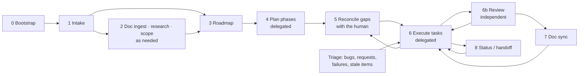

# The CeraNova PM lifecycle

CeraNova PM turns a repository into a self-tracking project:
- **per-phase kanbans** roll up into one **project board**;
- every task is a Markdown spec an agent (or a person) can pick up cold;
- **hooks** keep the boards and docs current in cloud and local sessions, for Claude Code, Codex, Gemini CLI, Cursor and OpenCode;
- every task says what it needs to run (tools, MCP servers, env var names, services), checked before anyone starts;
- a **human-in-the-loop reconciliation** loop keeps docs, decisions and tasks consistent.

It works for any git-based project: software, data/ML, research, documentation, design, games, film/audio/media pipelines.

## 0. Bootstrap (skill: `pm-bootstrap`)

1. Copy the kit into the repo (`install.sh /path/to/repo`), or merge it by hand (see [MERGING.md](MERGING.md)).
2. On the next prompt the agent reads `CLAUDE.md`/`AGENTS.md`, sees there's no `tracking/kanban.config.json`, and runs **pm-bootstrap**. It:
   - detects the project type and conventions;
   - merges hooks without clobbering existing ones;
   - runs `./kanban init`, configures task types if needed (e.g. `ASSET`/`EDIT`/`REVIEW` for media);
   - checks `./kanban doctor`;
   - commits.

## 1. Intake (skill: `pm-intake`)

The agent reads the code, existing docs and anything the human hands over, then fills in the templates:
- `GOAL.md`: what, for whom, why; non-goals; constraints;
- `SPEC.md`: core decisions and non-negotiables;
- `ARCHITECTURE.md`: components or pipeline stages;
- optionally `configuration.md`: every tunable value as a default, never hard-coded.

It asks the human **one batch** of questions, each with a proposed answer. Unknowns are marked (U) and become gaps.

## 2. Doc ingest (skill: `pm-doc-ingest`, optional)

When the human hands over another project's spec, research or a brief, the agent vets it:
- **direct overlap** is dropped, citing where it's already covered;
- **new specs and systematic approaches** are merged where they fit;
- **conflicts** are resolved, or listed as decisions for the human.

It writes a review doc so the reasoning is kept.

## 2b. Research and scoping (skills: `pm-research`, `pm-scope`, as needed)

- **pm-research:** outside facts (tools, repos and their licences/code, vendors and free tiers, regulation, prices) are researched with dated sources and **(U)** flags. Notes go in `docs/research/<topic>.md` and feed the decision docs.
- **pm-scope:** areas that need a contract before tasks (UI screens + design system with a viewport test matrix, API, data model, pipelines) get a `docs/<area>/` index plus one scope doc per unit, with acceptance criteria and a backend/data contract.

## 3. Roadmap (skill: `pm-roadmap`)

The work is cut into phases: foundations first, risky unknowns early, optional work last. Each gets:
- a roadmap doc with **requirement IDs** (`R2.07`);
- **typed ToDos** (`T2.22 BUILD`): `USER` (only the human), `BUILD`, `OPS`, `VERIFY`, `RUN` (elapsed time), `DOC`;
- exit criteria and risks.

The roadmap index carries the timeline, dependencies, fixed external dates, cross-phase tracks, traceability, and auto-generated blocks (live status, work mix, register of every `USER` action). `./kanban init --phases … --roadmap` / `phase-add` create the matching `tracking/phase-N/` folders.

## 4. Plan phases (skills: `pm-plan`, `pm-delegate`)

One planning agent per phase (a big phase is split A/B by workstream with separate ID ranges). Each writes:
- `PHASE.md`: entry/exit criteria, workstreams, critical path, full traceability;
- one **task file per branch/PR**: goal, references, requirements, ToDo, **tests / scenarios / stress checks**, acceptance, exceptions, **cardinal do-not rules**, doc sync, branch & PR, progress log;
- **gap/bug items** for every inconsistency it finds in the docs (S1–S4).

Triage is paused while agents write (`./kanban pause`). Afterwards the coordinator merges part files, validates, resumes triage and builds the boards.

## 5. Reconcile gaps with the human (skill: `pm-reconcile`)

The step that keeps everything true:
1. **Gather** open gaps, S1/S2 first.
2. **Explain** each in plain words with a recommendation.
   - Separate *configurable defaults* (propose a value; the user can change it later) from *real design choices* and *facts to verify*.
   - Correct misunderstandings kindly.
3. **The human answers in chat.** The agent records:
   - **configuration doc:** layers, defaults, failure behaviour, live inputs;
   - **decisions register:** one row per gap ID;
   - **roadmap:** new requirement/ToDo IDs for genuinely new work.
4. **Doc alignment wave:** agents own disjoint doc sets and apply the decisions. Headings are never renamed, so links keep working.
5. **Task alignment wave:** one agent per phase updates tasks, creates tasks for the new IDs, and **closes gaps with evidence** (`./kanban done B007 --evidence "decided in register row X; docs updated: …"`).
6. **Integrate:** validate, link check, rebuild, commit, push.

The loop repeats whenever new gaps appear (during execution too).

## 6. Execute (skills: `pm-execute`, `pm-delegate`)

Per task:
1. **Resume** whatever's in flight.
2. **Claim:** `./kanban start <ID> --git`. The **preflight** checks the item's `tools` (on PATH), `env` (variable names set), `mcp` (configured for an agent) and lists `services` to confirm. A missing tool or env var stops the start: install it, or block the item and raise a USER task.
3. **Implement** exactly what the task file says, ticking ToDos. Write a project skill only for a procedure you'll repeat.
4. **Checkpoint** after each step.
5. **Run** the listed tests, scenarios and stress checks.
6. **File bugs** found along the way.
7. **Open a PR** (`./kanban review <ID> --pr …`).
8. **Review** (skill: `pm-review`), ideally by a separate agent: re-run the verification, check each acceptance criterion, record `./kanban reviewed <ID> --pass|--fail --note "…"`. A fail sends the item back to in progress with the findings. `require_review: true` makes a pass mandatory before done.
9. **Finish:** `./kanban done <ID> --evidence "…"`. It refuses without ticked boxes and evidence.

**Triage** (skill: `pm-triage`) runs whenever something comes in: a bug report, a request, a CI or review failure. It searches for duplicates (`./kanban list --grep`), classifies kind, severity, phase and priority, files the item, and grooms stale or blocked ones.

Several phases can run in parallel once their prerequisites are done (one agent per phase).

## 7. Doc sync (skill: `pm-doc-sync`)

Completing an item queues its `doc_sync` docs (`tracking/DOC_SYNC.md`). The agent's end-of-turn hook (Stop in Claude Code and Codex, AfterAgent in Gemini CLI, stop in Cursor, session.idle in OpenCode) asks once per item to update them: spec, architecture, the roadmap (tick the ToDo), UI/user docs. Then `./kanban docsync <ID> --done`.

When a phase's tasks are all done, no S1/S2 is open and its exit criteria are ticked, the phase **flips to done automatically**, queues its own doc sync, and the next phase opens.

## 8. Status and handoff (skill: `pm-status`)

- **Status:** `KANBAN.md` / `kanban.html` show overall and per-phase progress bars, in progress (with checkpoints), blocked, next up, open S1/S2 and doc sync.
- **Handoff:** `./kanban session handoff` + commit + push.
- **Another machine** (cloud ↔ local): `git pull && ./kanban resume`. Nothing lives only in a session: status, checkpoints and append-only progress logs are all in git, so a crash or usage limit mid-task loses nothing.

## Doctor and question checkpoints

- **`./kanban doctor`** checks the setup (python, git, git hooks, Claude Code hooks, merge blocks, config, templates, validation) and prints the **lifecycle state as an ordered list of next steps**, each naming a skill. Examples:
  - foundation docs missing → `pm-intake`;
  - roadmap unfinished → `pm-roadmap`;
  - phases without tasks → `pm-plan` / `pm-delegate`;
  - S1/S2 gaps → `pm-reconcile`;
  - doc sync pending → `pm-doc-sync`;
  - items in review → `pm-review`;
  - ready tasks → `pm-execute`;
  - stale in-progress items → `pm-triage`;
  - ready tasks whose tools or keys are missing on this machine, and `USER` items → ask the human.
- **`./kanban doctor --fix`** repairs the safe things automatically: git hooks, agent session hooks (Claude Code always; Codex, Gemini CLI, Cursor, OpenCode when their folder exists), merge blocks, `.gitignore`, config, permissions, skills mirrored between `.claude/skills` and `.agents/skills`, boards.
- **Every session-start brief** includes "Lifecycle next", so the process continues by itself on the next prompt.
- **Checkpoints with the human:**
  - after intake (one batch of questions, each with a proposed answer);
  - after the roadmap (confirm phases, the `USER` register, fixed dates);
  - whenever S1/S2 gaps exist (`pm-reconcile`);
  - before anything needing the human's money, accounts, credentials or approval.

## What fires when

| Event | Agent session hook | Git hook (any tool/model) | Effect |
|---|---|---|---|
| Session starts | Claude Code / Codex / Gemini CLI `SessionStart`, Cursor `sessionStart`, OpenCode `session.created` | — | Enable git hooks if needed; log session (cloud/local, host, branch, active items); give the agent the resume brief |
| An item file changes | Claude Code / Codex `PostToolUse`, Gemini CLI `AfterTool`, Cursor `afterFileEdit`, OpenCode `tool.execute.after` | — | Triage (backlog ↔ ready, auto-unblock, doc-sync flags, phase status) + rebuild all boards |
| Turn ends after a completion | Claude Code / Codex `Stop`, Gemini CLI `AfterAgent`, Cursor `stop`, OpenCode `session.idle` | — | Ask once per completed item to sync docs |
| `git commit` | — | pre-commit | Run the project's own hook first; validate; rebuild boards into the commit |
| `git push` | — | pre-push | Block if invalid or boards stale; note pending doc sync |
| `git pull` / branch switch | — | post-merge / post-checkout | Print the resume brief |
| Manual | — | — | `.github/workflows/kanban.yml` (manual only) as a backstop for web-editor edits |

## Triage rules (automatic)

- `backlog` → `ready` when dependencies are done and the phase is open (`opens_after` phases done, or `force_open`).
- `ready` → `backlog` if a dependency reopens.
- `blocked` with `blocked_reason: auto:deps …` → `ready` once dependencies are done.
- `done` with docs listed → doc sync `pending`.
- `in_progress` untouched for N days → flagged stale.
- **Phase done** = all tasks done/cancelled + no open S1/S2 + exit criteria ticked.

## Progress maths

| Size | Weight |
|---|---|
| XS | 1 |
| S | 2 |
| M | 3 |
| L | 5 |
| XL | 8 |

| Status | Credit |
|---|---|
| `done` | 100% |
| `review` | 90% |
| `in_progress` | 10% + 70% × the share of ToDo boxes ticked |

Bugs/gaps are counted separately; open S1/S2 block phase completion.
