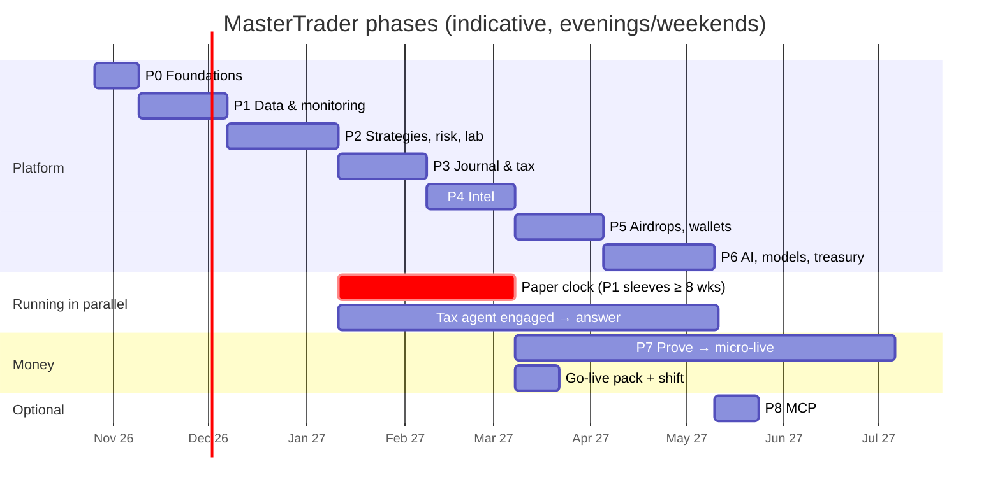
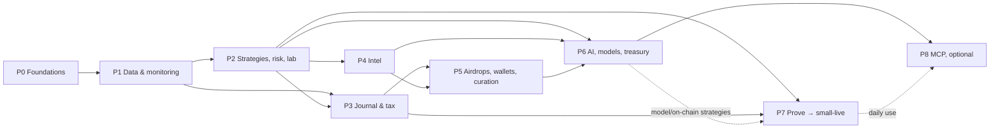

# MasterTrader Roadmap

This folder breaks the [plan of action](../04-plan-of-action.md) into **one scoped document per phase**. Execution is tracked per phase on kanbans in [`tracking/`](../../tracking/README.md). Each one has requirements (with IDs), ToDo sets split by **who or what does the work**, deliverables, exit criteria and risks. Every requirement and task links back to the spec, architecture, UI and research docs it comes from.

| Phase | Document | Weeks | If started Mon 2026-10-26 (evenings/weekends) |
|---|---|---|---|
| 0 | [Foundations & security baseline](phase-0-foundations.md) | 1–2 | 26 Oct – 8 Nov 2026 |
| 1 | [Market data, recording & live monitoring](phase-1-data-and-monitoring.md) | 3–6 | 9 Nov – 6 Dec 2026 |
| 2 | [Strategy framework, risk manager & research lab](phase-2-strategies-risk-lab.md) | 7–11 | 7 Dec 2026 – 10 Jan 2027 |
| 3 | [Journal & tax](phase-3-journal-and-tax.md) | 12–15 | 11 Jan – 7 Feb 2027 |
| 4 | [News, social, events & calendars](phase-4-intel.md) | 16–19 | 8 Feb – 7 Mar 2027 |
| 5 | [Airdrops, launches, wallets & curation](phase-5-airdrops-wallets-curation.md) | 20–23 | 8 Mar – 4 Apr 2027 |
| 6 | [AI decision layer, memory, models, anomalies & treasury](phase-6-ai-models-treasury.md) | 24–28 | 5 Apr – 9 May 2027 |
| 7 | [Prove it, then go small-live](phase-7-prove-and-go-live.md) | Month 7–10+ | Hard-gated: opens after P3; first funding once the paper clock (started ~10 Jan 2027) has run ≥ 8 weeks and the go-live pack and the shift are done, so ~Mar 2027 at the earliest |
| 8 | [MCP control plane (last, optional)](phase-8-mcp.md) | 1–2 weeks | Hard-gated: after P6, and only once the platform is in daily use |

Calendar dates are indicative; halve the durations if you work full-time.

**Workstation first, test, then shift** ([18 §9](../18-platform-and-deployment.md#9-workstation-first-build-path)): Phases 0–6 build, test and paper-trade on your workstation (Supabase CLI stack, Docker Compose, keyless fixtures). Nothing before Phase 7 needs a dedicated host, LUKS, Tailscale, a YubiKey or a GPU. In Phase 7, before any live money, you approve the go-live pack (T7.12), choose the runtime host (T7.13; default: stay on the workstation), move the age keys onto a YubiKey (T7.14), and the agent does the shift and reruns the full verification suite on the target (T7.44).

**Live status** (auto-updated from the phase kanbans by `./kanban build`; open [`kanban.html`](../../kanban.html) or [`KANBAN.md`](../../KANBAN.md) for the boards):

<!-- kanban:phase-status:start -->
| Phase | Status | Progress | Tasks done/total | Board |
|---|---|---|---|---|
| P0 Foundations & security baseline | `in_progress` | `░░░░░░░░░░░░░░░░` 0% | 0/74 | [BOARD](../../tracking/phase-0/BOARD.md) |
| P1 Market data, recording & live monitoring | `not_started` | `░░░░░░░░░░░░░░░░` 0% | 0/80 | [BOARD](../../tracking/phase-1/BOARD.md) |
| P2 Strategy framework, risk manager & research lab | `not_started` | `░░░░░░░░░░░░░░░░` 0% | 0/137 | [BOARD](../../tracking/phase-2/BOARD.md) |
| P3 Journal & tax | `not_started` | `░░░░░░░░░░░░░░░░` 0% | 0/61 | [BOARD](../../tracking/phase-3/BOARD.md) |
| P4 News, social, events & calendars | `not_started` | `░░░░░░░░░░░░░░░░` 0% | 0/73 | [BOARD](../../tracking/phase-4/BOARD.md) |
| P5 Airdrops, launches, wallets & curation | `not_started` | `░░░░░░░░░░░░░░░░` 0% | 0/69 | [BOARD](../../tracking/phase-5/BOARD.md) |
| P6 AI decision layer, memory, models, anomalies & treasury | `not_started` | `░░░░░░░░░░░░░░░░` 0% | 0/80 | [BOARD](../../tracking/phase-6/BOARD.md) |
| P7 Prove it, then go small-live | `in_progress` | `░░░░░░░░░░░░░░░░` 0% | 0/73 | [BOARD](../../tracking/phase-7/BOARD.md) |
| P8 MCP control plane (last, optional) | `not_started` | `░░░░░░░░░░░░░░░░` 0% | 0/35 | [BOARD](../../tracking/phase-8/BOARD.md) |
<!-- kanban:phase-status:end -->

---

## 1. How to read the phase documents

**IDs:**
- `R<phase>.<nn>`: a requirement (`R2.17`). `R<phase>.N<n>` is non-functional (security, latency, storage).
- `T<phase>.<nn>`: a ToDo. Each ToDo points (`→`) at the requirement(s) it satisfies and the doc section it comes from.

**ToDo types** (each phase groups its ToDos by type, A–F):

| Tag | Who / what | Examples |
|---|---|---|
| `USER` | **You.** Only you can do these: keys and accounts, KYC, money, wallets, legal or tax answers, facts only you know, approvals (C3), drills you take part in, weekly reviews. Configurable values (limits, sleeves, lists, schedules) are **not** `USER` items: agents seed them from the defaults and you approve them once in the go-live pack (T7.12) | Open a practice account; sign a mandate; engage the tax agent |
| `BUILD` | Code execution (you + Claude Code): crates, packages, services, UI, tests-as-code, runbooks | `mt-risk` policy model; D06 Risk |
| `OPS` | Infrastructure and configuration: containers, networks, secrets, schedules, dashboards | Compose services; sops secrets; Grafana boards |
| `VERIFY` | Checks that prove a requirement: tests, drills, benchmarks, reports, provider checks | Kill-switch drill; drainer test suite; bake-off report |
| `RUN` | Elapsed-time work: soaks, paper periods, observation windows | 7-day recording soak; ≥ 8-week paper clock |

**Every phase document has the same sections:** header (goal, duration, dependencies, modules, containers, dashboards, primary docs) · 1 Scope · 2 Entry criteria · 3 Requirements · 4 ToDo sets (A `USER`, B `BUILD`, C `OPS`, D `VERIFY`, E `RUN`, F docs) · 5 Deliverables · 6 Exit criteria · 7 Risks.

## 2. Work mix per phase

<!-- kanban:roadmap-counts:start -->
| Phase | Requirements | `USER` | `BUILD` | `OPS` | `VERIFY` | `RUN` | ToDos |
|---|---|---|---|---|---|---|---|
| [P0 Foundations & Security Baseline](phase-0-foundations.md) | 21 | 12 | 11 | 9 | 10 | 1 | 43 |
| [P1 Market Data, Recording & Live Monitoring](phase-1-data-and-monitoring.md) | 22 | 4 | 19 | 5 | 9 | 1 | 38 |
| [P2 Strategy Framework, Risk Manager & Research Lab](phase-2-strategies-risk-lab.md) | 47 | 5 | 27 | 4 | 15 | 2 | 53 |
| [P3 Journal & Tax](phase-3-journal-and-tax.md) | 21 | 6 | 14 | 3 | 8 | 1 | 32 |
| [P4 News, Social, Events & Calendars](phase-4-intel.md) | 19 | 5 | 15 | 3 | 9 | 1 | 33 |
| [P5 Airdrops, Launches, Wallets & Curation](phase-5-airdrops-wallets-curation.md) | 24 | 7 | 16 | 3 | 8 | 1 | 35 |
| [P6 AI Decision Layer, Memory, Models, Anomalies & Treasury](phase-6-ai-models-treasury.md) | 28 | 3 | 19 | 4 | 17 | 2 | 45 |
| [P7 Prove It, Then Go Small-Live](phase-7-prove-and-go-live.md) | 19 | 14 | 8 | 5 | 7 | 3 | 37 |
| [P8 MCP Control Plane (last, optional)](phase-8-mcp.md) | 10 | 2 | 6 | 1 | 6 | 1 | 16 |
| **Total** | | **58** | **135** | **37** | **89** | **13** | **332** |
<!-- kanban:roadmap-counts:end -->

## 3. Timeline & dependencies

**Critical path to live money:** P0 → P1 → P2 → (paper clock ≥ 8 weeks) + (tax agent's answer) → P7 → go-live pack (T7.12) + the shift, re-verified on the target (T7.44) → first funding. Phases 3–6 add capability while the paper clock runs; **they don't block a P1 sleeve (e.g. trend on majors) from going micro-live** once P3 is done and the gates pass.

**How work runs** ([17 §E](../17-decisions-register.md#e-ratification-2026-10-22)):
- **Parallel by dependency:** a task starts as soon as its own `depends_on` are done, in any phase (`phase_gating: "dependencies"`). P3 and P4 share no code; the `RUN` items (soaks, paper clock, digests) overlap other `BUILD` work. The Gantt chart above is one indicative sequence, not a gate.
- **Hard gates:** Phase 7 (go small-live) opens only after P3 exits (P2 transitively); its items that need P5/P6 deliverables carry their own task dependencies. Phase 8 (MCP) opens only after P6 and the T8.01 decision.
- **Build first, keys last:** integrations are built and tested against mocks, recorded fixtures, emulators, testnets and paper accounts without secrets. Live checks that need your keys, accounts or money are separate, late `VERIFY` ToDos that depend on the `USER` ToDo providing them.
- **Configurable values are settings, not decisions:** every number in the phase docs that comes from [16](../16-configuration-and-safety-model.md) is a default you change in settings. Agents seed the values a task needs (risk values, ceilings, sleeves, manifests) from the documented defaults; you approve them once in the go-live pack (T7.12, [17 §G](../17-decisions-register.md#g-platform-rust-and-python-supabase-vercel-workstation-first-2026-11-19)). No build task waits on you for a value.
- **Workstation first:** everything runs on your workstation until the Phase 7 shift ([18 §9](../18-platform-and-deployment.md#9-workstation-first-build-path)). Host hardening for live, the YubiKey and Tailscale for the egress node are Phase 7 items; GPU checks run only when a GPU is present.
- **Rust-max** ([17 §H](../17-decisions-register.md#h-rust-max-borrowed-code-rebuilt-in-rust-scenario-simulator-copyleft-register-2026-11-20)): everything we write is Rust, strategies included by default; Python only for the five packages in [18 §2.2](../18-platform-and-deployment.md#22-python-uv-workspace-packages-only-where-absolutely-required). Prefect, LangGraph, OpenBB and the Python data SDKs give way to `mt-scheduler`, `mt-agents` and `mt-connectors`. The scenario & crowd simulator (M14) is a go-live tool: built in P6, used in the P7 weekly reviews and pre-live stress tests.

## 4. Fixed external dates

| Date | Event | Affects | Source |
|---|---|---|---|
| **2026-10-31** | Reddit API closes to new apps (optional source) | T0.08 | [06 §0](../06-aggregators-and-market-providers.md#0-️-time-sensitive-actions) |
| Q4 2026 | ASIC consultation on renewing the crypto-CFD 2:1 order (U) | Venue registry, 2× cap | [12 §1](../12-policy-and-compliance.md#1-australian-boundary-the-load-bearing-assumption) |
| 2027-04-09 | Digital Assets Framework commences (binds platforms; venues may change products) | Quarterly venue re-check | [12 §1](../12-policy-and-compliance.md#1-australian-boundary-the-load-bearing-assumption) |
| 2027-05-23 | ASIC product-intervention order on retail crypto CFDs expires (U) | Venue registry | [12 §1](../12-policy-and-compliance.md#1-australian-boundary-the-load-bearing-assumption) |
| **2027-06-30** | EOFY; **market-value snapshot of every open lot** (2027 reform, behind a flag) | T3.25, T3.06 | [09 key findings](../09-journal-and-tax.md#️-key-findings-that-shape-the-design) |
| 2027-07-01 | Reported CGT reform start (status to be confirmed by your tax agent) | AU_2027_REFORM flag | [11 §3](../11-cryptotrader-crossover-review.md#3-conflicts-and-how-they-were-resolved) |
| Every quarter | AUSTRAC register re-check per venue | `VENUE_CHECK` tasks | [12 §2](../12-policy-and-compliance.md#2-venue-access-registry) |
| Every 90 days / monthly | Key rotation / restore test and ToS check | Standing rules | [04 standing rules](../04-plan-of-action.md#standing-rules) |

## 5. Cross-phase tracks

| Track | P0 | P1 | P2 | P3 | P4 | P5 | P6 | P7 | P8 |
|---|---|---|---|---|---|---|---|---|---|
| **Security** ([07](../07-security-notes.md)) | Workstation baseline, secrets (age key in the OS keychain), backups, segmentation, Supabase Auth + RLS deny-all | Read-only keys, alert channels | Trade-only keys, C3, hard ceilings, sandbox | Column encryption | Untrusted text, RSS-Bridge isolation | Signer, hard blocks, seed backup | Prompt injection, local model auth | Live hardening at the shift, YubiKey, live keys, fail-flat, drills | MCP never-exposed list |
| **Compliance & data terms** ([12](../12-policy-and-compliance.md)) | Venue registry table + seed | Provenance tags + retention, venue health | Registry check, 2× cap, STP | Tax agent engaged | Telegram postures only, Polymarket read-only | Never-automated list, no sybil | Label provenance | Advice items closed, quarterly re-check | Audit source = mcp |
| **UI** ([ui](../ui/README.md)) | Shell, D16 | D07, D02, D16 jobs | D01, D03–D06 | D14, D15 | D08 | D12, D13, D18 view | D09, D10, D11, D18 earn, scenario-twin report (D14) | Mobile/approvals polish, go-live pack (D16), simulated scenarios (D06 Stress) | D17 |
| **Testing** | `pit` (Rust + Python binding), hash chain, pgTAP, viewport matrix, licence audit | DQ fault injection, scheduler retries | Risk golden, kill drill, latency, lab binding parity | Tax golden, property | Telegram gate, RAG `as_of` | Drainer suite | Determinism, bake-off, simulator isolation | Kill-criteria sims, simulated-scenario stress, full suite on the shift target | Bypass + injection |
| **Runbooks** (`docs/runbooks/`) | Backup/restore, host rebuild, secret rotation | Bad data | Keys leaked, server down with positions, kill drill | — | — | Wallet drained | — | All drilled | — |

## 6. `USER` action register (all phases)

Everything only you can do, in order. The phase documents hold the detail. This table is generated from the `USER` ToDos in the phase documents (`./kanban build`).

**Changes in the re-platform (2026-11-19, [17 §G](../17-decisions-register.md#g-platform-rust-and-python-supabase-vercel-workstation-first-2026-11-19)):**

| Was | Now |
|---|---|
| T0.01 provision the host, decide on a GPU | Agent work (`OPS`, P0-T005): profile the workstation and pick CPU/GPU profiles. Nothing to buy |
| T0.03 Tailscale account + YubiKey | Tailscale optional until go-live (P0-T003); the YubiKey moved to **T7.14** (P7-T072) |
| T0.12 set the login password and TOTP | Same action, now on Supabase Auth (P0-T062) |
| T2.01 risk values and L0 ceilings · T2.02 sleeves · T2.05 first manifests | Agent seeds (`BUILD`, P2-T048 / P2-T049 / P2-T050), approved once in the go-live pack **T7.12** (P7-T070) |
| T2.08 start the paper clock | Automatic once validation passes (`OPS`, P2-T067) |
| T2.06 kill drill · T2.07 test C3 · T2.09 first bot walkthrough | Still yours, any time before go-live; no build task waits on them |
| — | New: **T7.12** go-live pack (P7-T070) · **T7.13** runtime host and cloud choice, default stay on the workstation (P7-T071) · **T7.14** YubiKey (P7-T072). The shift itself is agent work (**T7.44**, P7-T073) |

<!-- kanban:user-register:start -->
| ID | Phase | Action | Feeds / blocks |
|---|---|---|---|
| T0.02 | P0 | Order a **UPS** and a **4G failover** router (needed before live, cheap to set up early). | [07 §5](../07-security-notes.md#5-network--host) |
| T0.03 | P0 | Optional now: create the Tailscale tailnet with MFA on the identity provider (phone access; required at go-live). The YubiKey moved to Phase 7 (T7.14); until then the age key stays in the OS keychain. | R0.N2 · [18 §8](../18-platform-and-deployment.md#8-tailscale-and-the-hardware-key-per-mode) |
| T0.04 | P0 | Open the off-site backup target with **Object Lock** (e.g. Backblaze B2 compliance mode) or a second box running restic `rest-server --append-only`; store credentials in the secrets file. | R0.N4, R0.07 |
| T0.05 | P0 | Keep the GitHub repo **private**; turn on secret scanning. | [SPEC NN8](../../SPEC.md#non-negotiable-requirements) |
| T0.06 | P0 | **Telegram:** dedicated number (landline voice code or prepaid SIM), `api_id`/`api_hash`, 2-step password, bot via @BotFather. | gates P1 alerts, P4 ingest · [07 §10](../07-security-notes.md#10-social--scraping-accounts) |
| T0.07 | P0 | **Discord:** private "MasterTrader Feeds" server with `#mt-inbox` + category channels; bot app with Message Content intent; start following announcement channels you already know. | gates P4 · [06 §2](../06-aggregators-and-market-providers.md#2-final-m2-social--news-ingestion-stack) |
| T0.08 | P0 | ⚠️ **Reddit (optional): apply before 2026-10-31.** X stays deferred. | [06 §0](../06-aggregators-and-market-providers.md#0-️-time-sensitive-actions) |
| T0.09 | P0 | Free demo/practice accounts: OANDA practice, IG demo, Alpaca paper, IBKR paper, Binance + Bybit testnets. | gates P1/P2 |
| T0.10 | P0 | Free API keys: FRED, EIA, USDA NASS QuickStats, Myfxbook, CoinGecko Demo, CryptoRank Sandbox, Helius, Alchemy, GoPlus, Finnhub, CryptoPanic. | gates P1/P4/P5 · [06](../06-aggregators-and-market-providers.md) |
| T0.11 | P0 | **Venue checks:** look up each AU venue you may use on the AUSTRAC register by ABN; note products available to you as a retail client; send the results for the registry seed. | R0.06 · [12 §2](../12-policy-and-compliance.md#2-venue-access-registry) |
| T0.12 | P0 | Create your login (Supabase Auth: password) and enrol TOTP when you first open the app. | R0.08 |
| T0.13 | P0 | Obtain Anthropic and custom-endpoint API keys and put them in the secrets file (never chat/git). | R0.09, R0.13 |
| T1.02 | P1 | Create **read-only** API keys where the testnet offers them (Binance/Bybit testnets, IP-allow-listed) for reconciliation and fee-tier reads; OANDA practice, IG demo, Alpaca paper and IBKR paper use their normal credentials (no money at risk). All go in the secrets file. | R1.12 · [07 §3](../07-security-notes.md#3-broker--exchange-keys) |
| T1.03 | P1 | Before go-live: install the ntfy app on your phone and subscribe to the private topic (needs Tailscale, P0-T003). The email address and SMTP password are P1-T068; ntfy itself is checked on the workstation during the build. | R1.14 |
| T1.05 | P1 | Create an SMTP app password at your own mail provider and put it in the secrets file, or turn email alerts off (Telegram + ntfy remain). | R1.14 |
| T1.06 | P1 | Each quarter, when the reminder arrives, check every venue you use on the AUSTRAC register and record the result (recurring). | R1.13 · [12 §2](../12-policy-and-compliance.md#2-venue-access-registry) |
| T2.03 | P2 | Create **trade-only, IP-locked, no-withdrawal** keys on testnets/practice accounts, one sub-account per mode. | R2.N3 |
| T2.04 | P2 | Provide **MasterTradingBot** rule descriptions + historical signal/trade outputs for golden files. | R2.48 |
| T2.06 | P2 | Take part in the **kill-switch drill** from your phone (Telegram `/kill`, then C3 to turn off), any time before go-live; no build task waits on it. | R2.18 |
| T2.07 | P2 | Approve a test C3 loosening to prove the TOTP + cool-down path, any time before go-live; no build task waits on it. | R2.19 |
| T2.09 | P2 | Walk through your first bot (scope + mode) and do one HITL approval from Telegram end to end, any time before go-live; no build task waits on it. | R2.53, R2.54 |
| T3.01 | P3 | **Engage a tax agent.** Send the question list (09); the key one is **investor vs trader-in-business, answered before any live trade**; include the PAYG method, wash-sale window and perps treatment. | R3.07 · [09 questions](../09-journal-and-tax.md#questions-for-your-tax-agent-tracked-as-tasks) |
| T3.02 | P3 | Ask the agent to confirm the **2027 CGT reform status** and the 30 June 2027 transitional mechanism. | R3.08 |
| T3.03 | P3 | Export historical statements you already have (IBKR Flex, OANDA, IG, exchanges) for opening balances/lots. | R3.01, R3.05 |
| T3.04 | P3 | Register your accounts on the Accounts page and tag each `investment` or `trading`. | R3.04, R3.17 |
| T3.05 | P3 | Enter the residency timeline (AU from …; any planned moves). | R3.09 |
| T3.06 | P3 | Diary hard date: **30 June 2027** snapshot must run (end of day AEST). | R3.08 |
| T4.01 | P4 | List the Telegram channels you want monitored (joined from your dedicated account, slowly). | R4.02 · [07 §10](../07-security-notes.md#10-social--scraping-accounts) |
| T4.02 | P4 | Follow the Discord announcement channels into `#mt-inbox`/category channels (≈10–15 follows per receiving channel). | R4.04 |
| T4.04 | P4 | *Optional:* label ~200 sampled documents relevant/irrelevant with the labelling tool. Agent silver labels calibrate the SemIf gate by default ([10 §4.3](../10-memory-rag-and-models.md#43-design)); yours improve it and nothing waits on them. | R4.12, R4.16 |
| T4.05 | P4 | Confirm whether Reddit access was granted (if yes it joins as optional; if it wasn't granted by the 2026-10-31 deadline, Reddit stays out and needs no build ToDo). | [06 §2](../06-aggregators-and-market-providers.md#2-final-m2-social--news-ingestion-stack) |
| T4.06 | P4 | Get the free NASA FIRMS / ACLED keys and confirm the OpenSanctions licence terms for personal use. | R4.08 |
| T5.01 | P5 | Set up the **vault** (air-gapped hardware) and **warm** hardware wallet yourself; the system only gets public addresses. | R5.01 |
| T5.02 | P5 | **Seed backup:** Shamir (SLIP-39) shares or multisig, stored in separate locations; write the sealed **estate letter** (where shares are, how to unwind, no secrets). | [07 §4](../07-security-notes.md#4-crypto-wallets-airdrops-on-chain-claims) |
| T5.03 | P5 | Approve creation of the hot, identity (one per chain) and burner keys in the signer; fund them with minimal floats. | R5.01, R5.07 |
| T5.04 | P5 | Register every address/account you own, with role and investment/trading tag; prove control by signing a one-time challenge in **your own wallet app** or making a tiny self-transfer (the system never signs). | R5.05, R5.25 |
| T5.05 | P5 | Sign the first **mandates** (C3): wallet, chain, allowed contracts/functions, caps, expiry. | R5.15 |
| T5.07 | P5 | Work the task queue: join/follow communities, do social tasks yourself, ICO reviews. | R5.20, R5.21 |
| T5.09 | P5 | Until the P7 live gates pass, sell claimed airdrop tokens yourself when the disposal task arrives, then mark it done. | R5.17 |
| T6.02 | P6 | *Optional:* work the **D10 labelling queue** (~15 min/day while it's new). Agent silver labels are the default; yours improve them and nothing waits on them. | R6.13 |
| T6.03 | P6 | Approve the **treasury policy** and protocol allow-list (C3); decide on HLP (only if Hyperliquid is approved; default cap ≤ 10% of stables and ≤ 5% of portfolio). | R6.20–R6.22 |
| T6.05 | P6 | Approve/edit/skip social drafts and click Post yourself (if M23 is on). | R6.31 |
| T7.01 | P7 | **Tax agent decision recorded** (investor vs trader) and set in D15 for the FY. | entry criterion · R7.13 |
| T7.02 | P7 | Open/verify **live accounts** (KYC) at the venues the registry allows; create live **sub-accounts per mandate**. | R7.04 |
| T7.03 | P7 | Create live keys: trade-only, IP-locked, no withdrawals; pre-register withdrawal addresses (Travel Rule). | R7.04 |
| T7.04 | P7 | Set each bot's starting live allocation in its strategy settings (default A$2,000) and fund the sub-account only after the gate report passes. | R7.05 |
| T7.05 | P7 | Run the **weekly review** (30–45 min) and sign it off in the journal. | R7.03 |
| T7.06 | P7 | Approve each promotion (bot HITL → autonomous is C3); approve each capital step (+25% of the current allocation) after 4 consecutive clean weeks. | R7.05, R7.08 |
| T7.07 | P7 | Optional professional advice: Hyperliquid exposure, OKX AU derivatives status, a written "private, non-commercial" boundary. | R7.13 |
| T7.08 | P7 | FP Markets: read client-agreement clauses on algo trading/scalping/hedging; set up the Windows VPS near the MT5 server (if MT5 route). | R7.10 |
| T7.09 | P7 | Install the UPS and 4G failover; do the pull-the-plug drill with paper positions. | R7.11 |
| T7.10 | P7 | Put the 12-month review in your calendar as a recurring review (not a phase item; [README §10](README.md#10-standing-operations-recurring-outside-the-phases)): keep only sleeves with positive live net P&L, live Sharpe > 0.5 and beating the benchmark. | R7.05 |
| T7.11 | P7 | Provision the egress VM (free tier where available, else a small paid VM in Sydney) and allow-list its IP on every live key. | R7.14 |
| T7.12 | P7 | Approve the **go-live pack** (D16 → Go-live preflight → Settings pack): the risk values, L0 ceilings, sleeves and manifests the agents seeded (T2.01, T2.02, T2.05), in one C3 approval before the first funding. | R7.17 |
| T7.13 | P7 | Choose the go-live **runtime host** (workstation, home server or Sydney cloud VM) and the cloud options (Vercel for the web app, Supabase cloud for the database); default: stay on the workstation. The agent prepares a one-page comparison first. | R7.18 · [18 §5](../18-platform-and-deployment.md#5-deployment-modes) |
| T7.14 | P7 | Move the age identities onto a **YubiKey** before live keys exist (moved here from T0.03), following the agent's step-by-step instructions. | R7.19 · [18 §8](../18-platform-and-deployment.md#8-tailscale-and-the-hardware-key-per-mode) |
| T8.01 | P8 | **Decide whether to build MCP** (decision gate above). | — |
| T8.02 | P8 | Configure your MCP client (Claude Desktop/Code) with the server and a scoped token. | R8.02 |
<!-- kanban:user-register:end -->

## 7. Traceability

### 7.1 SPEC non-negotiables → requirements
| # | Non-negotiable ([SPEC](../../SPEC.md#non-negotiable-requirements)) | Requirements |
|---|---|---|
| 1 | Point-in-time data | R0.04, R4.07, R6.04 |
| 2 | Every order through the risk manager | R2.10, R8.04 |
| 3 | No trading on bad data | R1.10, R2.16 |
| 4 | Sandboxed generated code | R2.45 |
| 5 | Exchange keys: no withdrawals, IP-locked, sub-accounts | R2.N3, R7.04 |
| 6 | Hot wallet only, mandates, simulation, no permits | R5.02, R5.03, R5.15 |
| 7 | Append-only audit and journal, ≥ 7 years, tested backups | R0.07, R0.N4, R3.02 |
| 8 | No telemetry/referral tags; private repo | R0.N5, T0.05 |
| 9 | Promotion gates before live capital | R2.42, R7.01, R7.02 |
| 10 | Data terms enforced by provenance (no Telegram text to models) | R0.05, R1.09, R4.03, R6.13 |
| 11 | Only `allowed` venues; explicit STP; no manipulation | R0.06, R2.17, R2.31 |

### 7.2 GOAL capabilities → phases
| Capability ([GOAL](../../GOAL.md)) | Phases |
|---|---|
| Ingest market, macro, fundamental, news, social, calendar, global-event data | P1, P4 |
| Research: build, backtest, validate, optimise, paper-trade with measured costs | P2 (paper clock → P7) |
| Decide with AI agents, valuation tools, RAG memory | P4 (RAG, SemIf), P6 |
| Built-in, user-configurable risk manager | P2 (+ P5 on-chain, P7 capital steps) |
| Live data-quality, cost and anomaly monitoring | P1, P2 (TCA), P6 (anomalies) |
| Execute from paper to live behind the risk manager | P2 (paper), P7 (live) |
| Audit trail, journal, tax (AU now, pluggable later) | P0 (audit), P3 |
| Airdrops/launches vetted; autonomous only where safe; user tasks otherwise | P5 |
| Community curation on a daily/weekly cadence | P5 |
| MCP control (optional, last) | P8 |

### 7.3 Modules → phases
| Module | Built in | Extended in |
|---|---|---|
| M0 Strategy framework | P2 | P6 (LLM-signal), P7 (MasterTradingBot merge) |
| M1 Market & macro data | P1 | — |
| M2 News & social | P4 | — |
| M3 Global events | P4 | — |
| M4 Airdrops & launches | P5 | — |
| M5 Calendars | P4 | — |
| M6 Features | P2 (core) | P4 (sentiment/regime, positioning) |
| M7 Research lab | P2 | P6 (distillation), P7 (gate reports) |
| M8 Agents | P6 | P8 (via MCP) |
| M9 Memory & RAG | P4 (RAG) | P6 (Hindsight) |
| M10 Anomaly | P6 | — |
| M11 Risk manager | P2 | P4 (blackouts), P5 (on-chain), P7 (capital steps, kill criteria) |
| M12 Execution | P2 (paper) | P5 (DEX path), P7 (live, MT5/cTrader) |
| M13 MM sidecar | P6 (optional) | — |
| M14 Scenario & crowd simulator | P6 (`mt-crowdsim`, scenario twin) | P7 (weekly reviews, pre-live stress tests) |
| M15 UI & alerts | P0 (shell) | Every phase |
| M16 Cost & DQ monitor | P1 | P2 (TCA), P5 (on-chain monitors), P7 (recon hardening) |
| M17 Observability & audit | P0 | Every phase |
| M18 Journal & tax | P3 | P5 (airdrop/staking income) |
| M19 Task queue & curation | P5 | P6 (social drafts) |
| M20 MCP | P8 (optional) | — |
| M21 Decision One & models | P0 (gateway, TEI), P2 (tier A) | P4 (SemIf), P6 (own heads, bake-off) |
| M22 Wallets, treasury, hold-and-earn | P5 (custody, signer, view) | P6 (earn, treasury) |
| M23 Social participation | P6 (optional) | — |

### 7.4 Dashboards → phases
| Dashboard | Phase | Dashboard | Phase |
|---|---|---|---|
| [D01 Cockpit](../ui/dashboards/D01-cockpit.md) | P2 | [D10 Models & Memory](../ui/dashboards/D10-models-memory.md) | P6 |
| [D02 Markets](../ui/dashboards/D02-markets.md) | P1 | [D11 Market Making](../ui/dashboards/D11-market-making.md) | P6 (optional) |
| [D03 Strategies](../ui/dashboards/D03-strategies.md) | P2 | [D12 Airdrops & Launches](../ui/dashboards/D12-airdrops.md) | P5 |
| [D04 Research Lab](../ui/dashboards/D04-research-lab.md) | P2 | [D13 Tasks & Curation](../ui/dashboards/D13-tasks-curation.md) | P5 (+ P6 drafts) |
| [D05 Execution](../ui/dashboards/D05-execution.md) | P2 | [D14 Journal](../ui/dashboards/D14-journal.md) | P3 |
| [D06 Risk](../ui/dashboards/D06-risk.md) | P2 | [D15 Tax & Reports](../ui/dashboards/D15-tax.md) | P3 |
| [D07 Data & Quality](../ui/dashboards/D07-data-quality.md) | P1 | [D16 System](../ui/dashboards/D16-system.md) | P0 |
| [D08 Intel](../ui/dashboards/D08-intel.md) | P4 | [D17 MCP Console](../ui/dashboards/D17-mcp-console.md) | P8 |
| [D09 Agents](../ui/dashboards/D09-agents.md) | P6 | [D18 Wallets & Treasury](../ui/dashboards/D18-wallets-treasury.md) | P5 (view) / P6 (earn) |

### 7.5 Documents → phases
| Document | Used mainly in |
|---|---|
| [GOAL](../../GOAL.md), [SPEC](../../SPEC.md) | All (scope and non-negotiables) |
| [01 Repo vetting](../01-repo-vetting-report.md) | P0 (vendoring), P2 (Nautilus, freqtrade analyser ideas), P6 (TradingAgents, FinRobot, Hummingbot designs) |
| [02 Architecture](../02-v1-architecture.md) | All (containers, subjects, API, flows, SLOs, degraded modes) |
| [03 Build spec](../03-build-spec.md) | All (module behaviour, gates) |
| [04 Plan of action](../04-plan-of-action.md) | Summary of this roadmap |
| [05 SaaS legal](../05-saas-legal-and-licensing.md) | Not in scope (personal use); provenance flags keep the option open |
| [06 Providers](../06-aggregators-and-market-providers.md) | P1, P4, P5 |
| [07 Security](../07-security-notes.md) | P0, P2, P5, P7 |
| [08 Airdrops](../08-airdrops-and-token-launches.md) | P5 |
| [09 Journal & tax](../09-journal-and-tax.md) | P3 (+ P5 income) |
| [10 Memory, RAG, models](../10-memory-rag-and-models.md) | P0 (gateway, TEI), P2 (tier A), P4 (RAG, SemIf), P6 |
| [11 CryptoTrader review](../11-cryptotrader-crossover-review.md) | Background for 12–14 |
| [12 Policy & compliance](../12-policy-and-compliance.md) | P0 (registry), P1 (provenance), P2 (registry, STP), P4 (Telegram), P7 (advice) |
| [13 Wallets & on-chain](../13-wallets-treasury-and-onchain.md) | P5, P6 |
| [14 Strategy evidence](../14-strategy-evidence-and-validation.md) | P2 (templates, risk defaults, harness), P7 (capital steps) |
| [16 Configuration](../16-configuration-and-safety-model.md), [17 Decisions](../17-decisions-register.md) | All (defaults and decisions; 17 §G the re-platform, §H Rust-max) |
| [18 Platform & deployment](../18-platform-and-deployment.md) | All (stack, crate and package lists, repository layout, database, auth); P0 (workstation stack), P1 (bars without TimescaleDB, scheduler, connectors), P2 (lab split), P6 (simulator), P7 (the shift) |
| [19 Third-party register](../19-third-party-register.md) | P0 (licence audit), any release work |
| [DESIGN](../../DESIGN.md), [UI scope](../ui/README.md) | Every phase with UI work |

## 8. Definition of done (every phase)

1. All requirements of the phase verified (the "Verified by" column), and the exit demo runs.
2. CI green: lint (`cargo clippy`, ruff), types, unit + golden tests (`cargo test`, `uv run pytest`, `supabase test db`), `pit` test (Rust and the Python binding), Playwright viewport matrix + axe for new screens.
3. New services pinned by digest, on the right network, with health checks and Grafana panels.
4. Every new user action is an `mt-api` command with the right confirmation level, audited.
5. Runbooks updated for any new failure mode; docs updated where behaviour changed.
6. The phase's `USER` items are done or explicitly deferred with a reason.
7. Every task passed an independent review (`require_review`) before it was marked done.

## 9. Tracking progress

Tick the checkboxes in each phase document as work lands (one commit per ToDo or small group, with the `T` IDs in the commit message). Add `(deferred: reason)` to anything pushed to a later phase rather than deleting it.

## 10. Standing operations (recurring, outside the phases)

These recur for as long as the platform runs. They are calendar tasks, not phase items, so no phase waits for them to "finish".

| Operation | Cadence | Owner | Source |
|---|---|---|---|
| Weekly review (tracking error, costs, DQ incidents, recon, five worst trades, scenario-twin report) | Weekly, from the first live week | You (T7.05) | [P7](phase-7-prove-and-go-live.md) |
| Capital steps after P7 closes (+25% of current allocation after 4 consecutive clean weeks; C3) | When earned | You + system | [16 §2.5](../16-configuration-and-safety-model.md#25-capital-steps-per-sleevebot) |
| **12-month review** (keep only sleeves with positive live net P&L, live Sharpe > 0.5, beating the benchmark) | Yearly from the first live funding | You (T7.10, T7.82) | [14 §7](../14-strategy-evidence-and-validation.md#7-phase-capital-steps--kill-criteria-refines-04-phase-7) |
| AUSTRAC register re-check per venue | Quarterly (and < 90 days before each funding) | You (T1.06, T7.63) | [12 §2](../12-policy-and-compliance.md#2-venue-access-registry) |
| Restore test; immutable WORM export | Monthly | System, alerts you | [P0 R0.N4](phase-0-foundations.md) |
| ToS check of free data sources | Monthly | Agent, reported to you | [04 standing rules](../04-plan-of-action.md#standing-rules) |
| Key rotation | Every 90 days | You | [04 standing rules](../04-plan-of-action.md#standing-rules) |
| Reminder for indefinite MCP tokens (if P8 is built) | Monthly | System | [16 §2.12](../16-configuration-and-safety-model.md#212-mcp-phase-8) |
